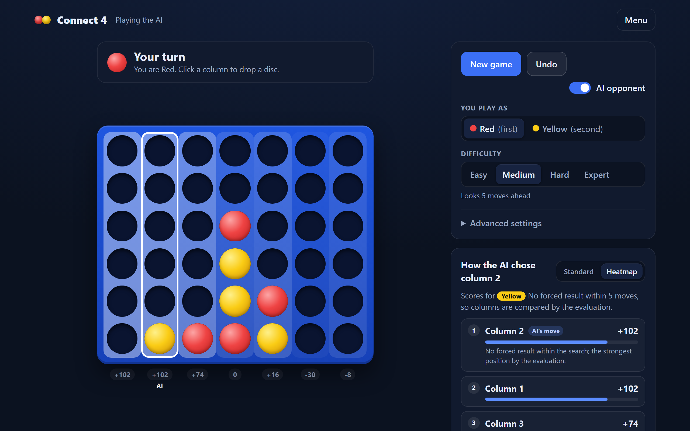
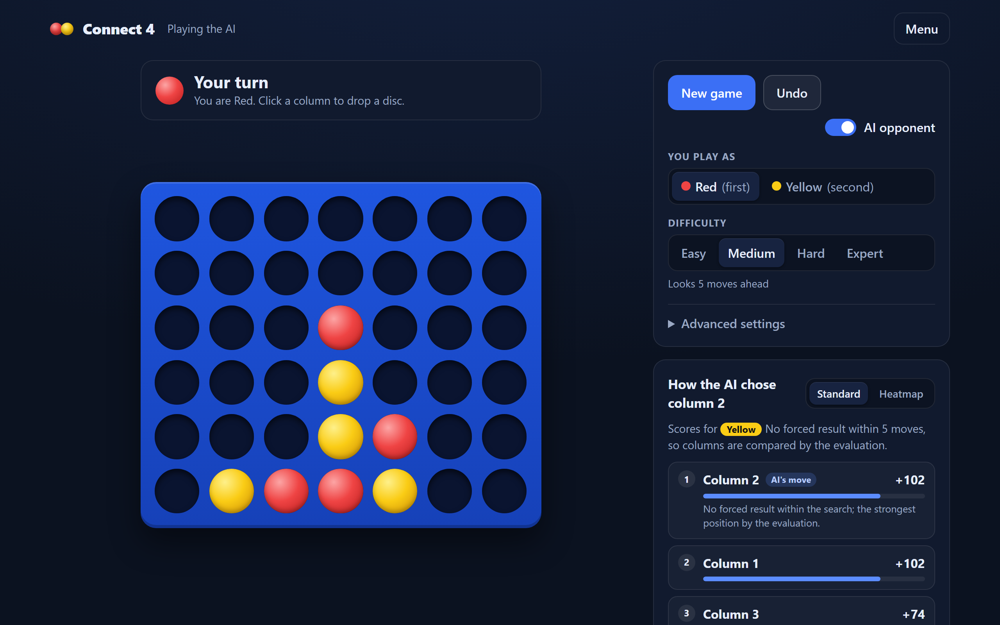

# Connect 4 AI Heatmap

Play Connect 4 against a C++ engine that runs in your browser, and see how it rates every move.

The engine is written in C++20 and compiled to WebAssembly with Emscripten. It runs in a Web Worker, so the whole app is static files with no backend. A React and TypeScript frontend draws the board and shows the engine's analysis as a heatmap and a ranked list of moves.



The same position in Standard view, with the board colours turned off for a plain game:



## Features

- **Play the AI or a friend.** Choose your colour and one of four difficulty levels, or play two players on one device. Undo works in both modes.
- **See what the AI thinks.** Each time the AI moves, it scores every column of the position it moved from. It doesn't analyse your moves unless you ask:
  - **Heatmap view:** the board columns are tinted by strength, with forced wins and losses labelled "Win in n" and "Loss in n".
  - **Analysis panel:** the columns ranked best first, each with a short explanation.
  - **Hint:** ask the engine to score the columns for your own move. In two-player mode this is the only way to see the analysis.
  - **Standard view:** turns the board colours off for a plain game.
- **Engine statistics** for people who want the details: the search depth reached, the time taken and the number of positions searched. Advanced settings let you set the search depth and the time limit directly.
- **Polished board:** falling discs, a preview disc above the hovered column, highlighted winning discs, and a layout that adapts to phones.

## The engine

The C++ engine ([`engine/`](engine/README.md)) searches with:

- **Negamax with alpha–beta pruning** over a bitboard position: two 64-bit integers that enable efficient move generation and four-in-a-row detection using bitwise operations.
- **Iterative deepening under a time limit.** Results come only from searches that finished.
- **A transposition table** that stores the best move found, and move ordering that tries the most threatening moves first.
- **Tactical pruning** that keeps scores identical to plain minimax. The tests check this against an unpruned search.
- **An opening book** for every position with up to 3 discs, precomputed at depth 16. Its scores are depth-limited evaluations, not solved game values. On the empty board the engine always opens in the centre, the known best first move.

At depth 12 the native build is 30–95 times faster than the original TypeScript engine on the benchmark positions. In head-to-head games at 100 ms and 250 ms per move, it won 11, drew 1 and lost 2 of 14 games at each limit. Full results are in [docs/benchmarks.md](docs/benchmarks.md).

## Running locally

**Requirements:** Node.js 24 and pnpm 9. Run `corepack enable` once to use the pnpm version pinned in `package.json`. The compiled WebAssembly engine is committed, so you don't need a C++ toolchain to run the app.

```sh
pnpm install
pnpm dev:web
```

Open http://localhost:5173.

To try the production build, which is what would be deployed:

```sh
pnpm --filter @connect4/web build
pnpm --filter @connect4/web exec vite preview   # http://localhost:4173
```

The output in `apps/web/dist/` is a static site that can be served by any static host.

## Tests

| Command | What it runs |
| ------- | ------------ |
| `pnpm test` | TypeScript unit tests, the WebAssembly engine tests, and the shared rule tests |
| `pnpm test:e2e` | Browser tests with Playwright. Run `pnpm exec playwright install chromium` once first |
| `pnpm --filter @connect4/web typecheck` | Type-checks the web app |
| `ctest --test-dir engine/build --output-on-failure` | Native C++ engine tests (build the engine first, see below) |

The TypeScript and C++ rules are tested against the same corpus of 63 complete games to catch inconsistencies between the implementations. GitHub Actions builds and tests the engine with GCC, Clang, MSVC and Emscripten, then runs every test above on each push and pull request. See [docs/testing.md](docs/testing.md).

## Working on the engine

You only need this if you change the C++ code.

**Native build and tests** (CMake 3.20+, a C++20 compiler):

```sh
cmake -S engine -B engine/build
cmake --build engine/build
ctest --test-dir engine/build --output-on-failure
engine/build/connect4_bench          # search benchmark
```

**Rebuilding the WebAssembly engine** used by the app requires the [Emscripten SDK](https://emscripten.org/docs/getting_started/downloads.html) (built and tested with 6.0.13). Activate it, then run:

```sh
pnpm build:wasm
```

This writes `connect4.js` and `connect4.wasm` into `apps/web/src/engine/generated/`. Commit both files, because CI fails if they don't match the engine sources. On Windows with Git Bash, `emsdk_env.sh` doesn't set up the environment; see [engine/README.md](engine/README.md#webassembly-build) for the manual setup.

The opening book is regenerated with `connect4_make_book`, which takes about 8 minutes. The command is in the engine README.

## Project layout

| Path | Contents |
| ---- | -------- |
| [`apps/web/`](apps/web) | React + Vite frontend: start screen, board, controls and analysis panel |
| [`apps/web/src/engine/`](apps/web/src/engine) | Web Worker, WebAssembly wrapper and the committed engine build |
| [`engine/`](engine/README.md) | C++ engine: search, evaluation, transposition table, opening book, C bindings, tests and benchmark |
| [`packages/core/`](packages/core) | Shared TypeScript game rules used by the UI |
| [`apps/api/`](apps/api) | The original TypeScript engine, kept only as a reference for benchmarks and tests. The website doesn't use it, and there is no server |
| [`tests/`](tests) | Cross-package tests, shared fixtures and Playwright browser tests |
| [`scripts/`](scripts) | WebAssembly build script and game-corpus generator |
| [`docs/`](docs) | Design and reference documentation |

## Documentation

- [docs/algorithm.md](docs/algorithm.md): how the engine chooses a move, from bitboards to the opening book
- [docs/api.md](docs/api.md): the `chooseMove()` contract between the UI and the engine
- [docs/heatmap.md](docs/heatmap.md): how scores become heatmap colours, badges and analysis rows
- [docs/benchmarks.md](docs/benchmarks.md): search speed and TypeScript vs C++ comparisons
- [docs/testing.md](docs/testing.md): test layers and CI
- [engine/README.md](engine/README.md): engine build, design and internals

## Status

The app is a fully static build with no backend. Still to do: deploy to Vercel.
